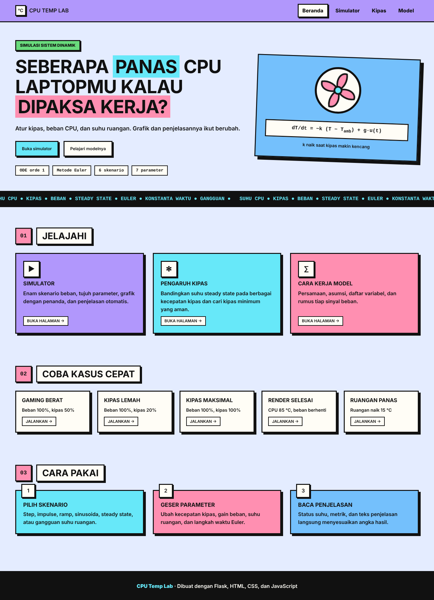
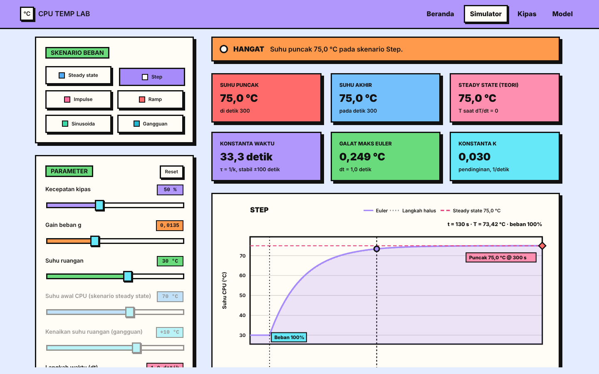
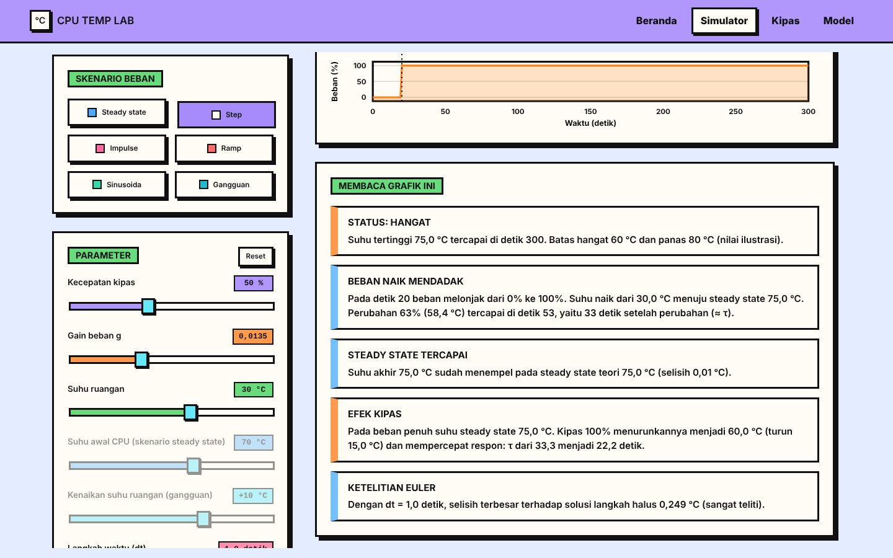
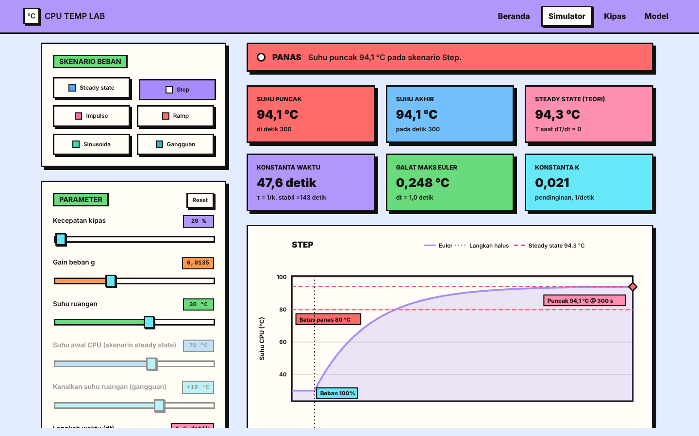
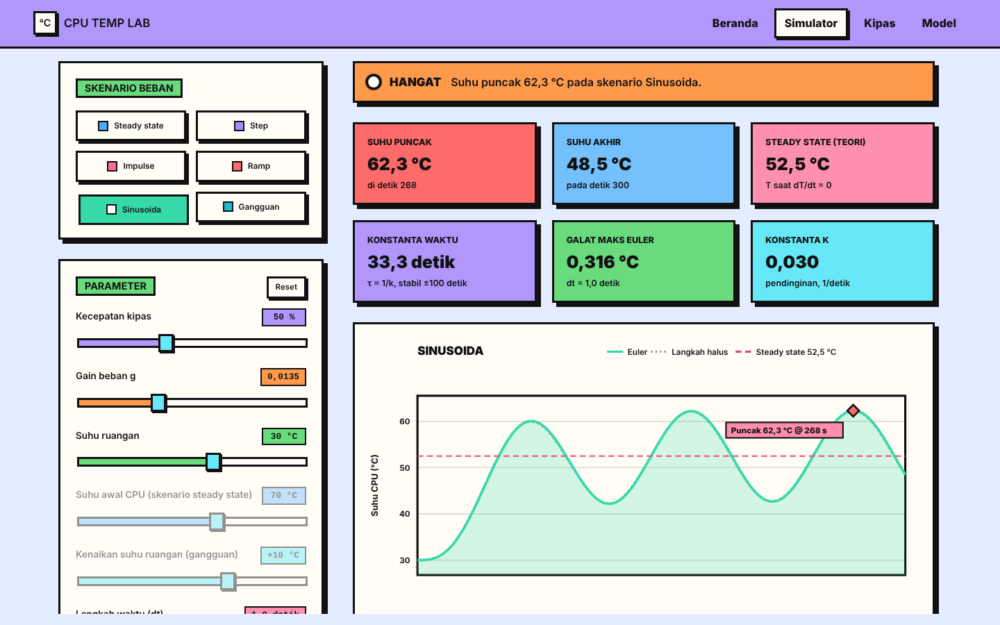
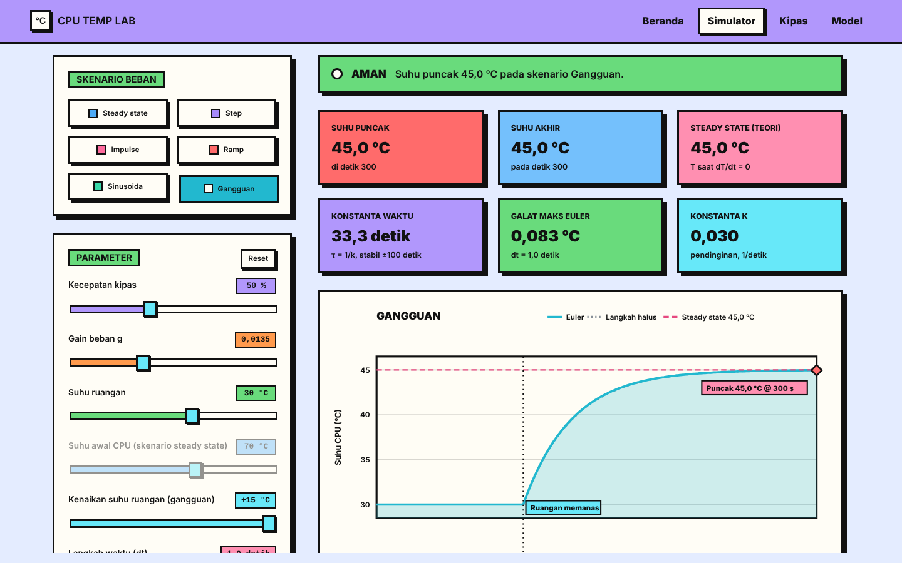
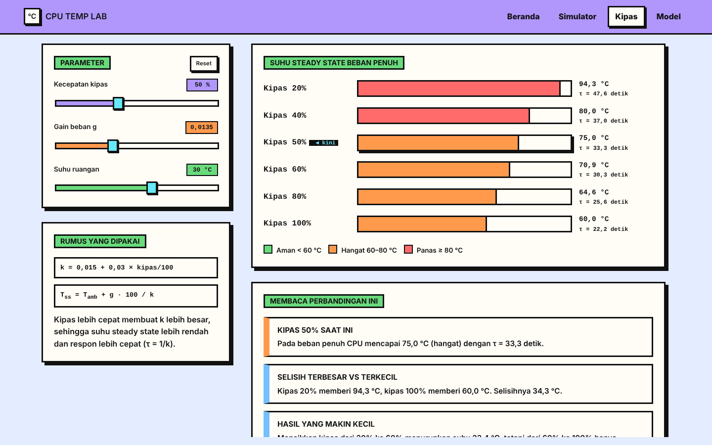
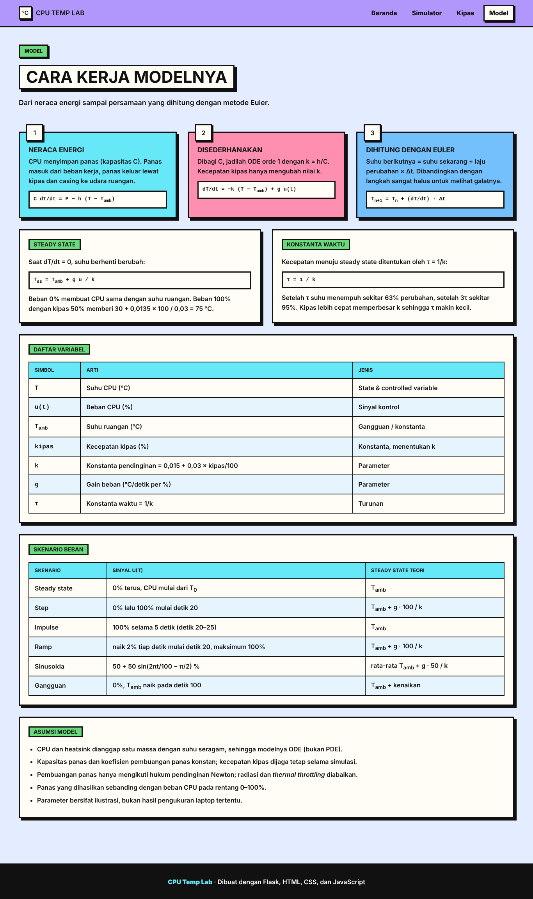
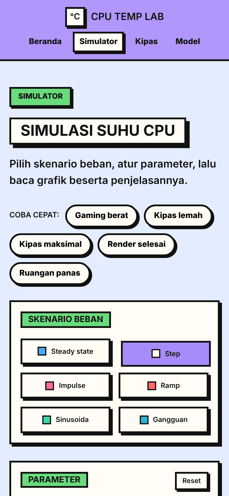

# CPU Temp Lab: Simulasi Suhu CPU Laptop + Kipas

Aplikasi web interaktif untuk Tugas Akhir 06 Praktikum Pemodelan dan Simulasi (Sistem Dinamik). Pengguna mengatur kecepatan kipas, beban CPU, dan suhu ruangan, lalu melihat grafik suhu beserta penjelasan yang berubah mengikuti angka hasil simulasi. Desain bergaya Neo-Brutalism, terdiri dari 4 halaman. Repositori ini juga memuat skrip `main.py` dan notebook `notebook/simulasi_cpu.ipynb` untuk model yang sama.

## Halaman

| Alamat | Isi |
|--------|-----|
| `/` | Beranda: pengantar, menu, 5 kasus cepat, cara pakai |
| `/simulator` | Simulator: 6 skenario, 7 parameter, grafik, metrik, penjelasan otomatis |
| `/kipas` | Pengaruh kipas: perbandingan suhu steady state dan kipas minimum yang aman |
| `/model` | Cara kerja model: persamaan, variabel, skenario, asumsi |

## Tampilan aplikasi

### Beranda



### Simulator

Skenario step, dengan penjelasan yang dibuat dari angka hasil:



Panel kanan punya scrollbar sendiri dengan tinggi sama seperti panel kiri. Bagian "Membaca grafik ini" ada di bawah grafik:



Kipas lemah (kipas 20%), status berubah menjadi panas dan garis batas panas muncul:



Sinusoida:



Gangguan suhu ruangan:



### Pengaruh kipas



### Cara kerja model



### Tampilan HP



## Model

```
dT/dt = -k (T - T_amb) + g u(t),    k = 0,015 + 0,03 x kipas/100
```

| Simbol | Arti | Jenis |
|--------|------|-------|
| T | Suhu CPU (°C) | State dan controlled variable |
| u(t) | Beban CPU (%) | Sinyal kontrol |
| T_amb | Suhu ruangan (°C) | Gangguan / konstanta |
| kipas | Kecepatan kipas (%) | Konstanta, menentukan k |
| g | Gain beban (°C/detik per %) | Parameter |

Penyelesaian memakai metode Euler. Sebagai pembanding galat dipakai Euler dengan langkah 0,01 detik. Parameter bersifat ilustrasi dan model tidak memasukkan thermal throttling.

## Struktur proyek

Satu file hanya berisi satu bahasa pemrograman.

```
app.py                 # Flask: halaman dan API
simulation.py          # model ODE, skenario, validasi parameter, metode Euler
insights.py            # penjelasan berbahasa Indonesia yang dibuat dari angka hasil
templates/
  base.html            # kerangka bersama (navigasi, footer)
  index.html  simulator.html  kipas.html  model.html
  _sliders.html        # potongan slider parameter
static/
  style.css
  common.js            # fungsi bersama: slider, format angka, permintaan ke API
  simulator.js         # grafik SVG dan panel simulator
  kipas.js             # batang perbandingan kipas
main.py                # skrip: simpan grafik simulasi ke outputs/
outputs/               # grafik hasil main.py
notebook/simulasi_cpu.ipynb   # versi notebook (Google Colab / Jupyter)
tests/                 # uji unit (model, penjelasan, halaman dan API)
docs/                  # screenshot aplikasi
requirements.txt       # dependensi aplikasi web (Flask, gunicorn)
requirements-notebook.txt   # dependensi main.py dan notebook (numpy, matplotlib)
Procfile               # perintah start untuk deploy
```

## Cara menjalankan

Python 3.10 atau lebih baru.

```bash
python -m venv venv
venv\Scripts\activate          # Windows (Linux/macOS: source venv/bin/activate)
pip install -r requirements.txt
python app.py
```

Buka http://127.0.0.1:5000 di browser.

Skrip dan notebook (membutuhkan numpy dan matplotlib):

```bash
pip install -r requirements-notebook.txt
python main.py          # simpan grafik ke outputs/
```

Atau buka `notebook/simulasi_cpu.ipynb` di Google Colab atau Jupyter, lalu pilih Run All.

## Deploy

Aplikasi siap di-deploy ke layanan yang mendukung Python (Render, Railway, dll.). Perintah build `pip install -r requirements.txt`, perintah start `gunicorn app:app` (sudah ada di `Procfile`).

## Pengujian

```bash
python -m unittest discover -s tests -t .
```

## API

`POST /api/simulate`

```json
{"scenario": "step", "params": {"fan": 80, "g": 0.0135}}
```

Mengembalikan data grafik, metrik, penanda peristiwa, dan daftar penjelasan.

`POST /api/fans`

```json
{"params": {"fan": 50, "t_amb": 30}}
```

Mengembalikan suhu steady state beban penuh untuk beberapa kecepatan kipas dan daftar penjelasan.

Parameter yang tidak dikirim memakai nilai bawaan. Skenario atau nilai di luar rentang menghasilkan status 400.
